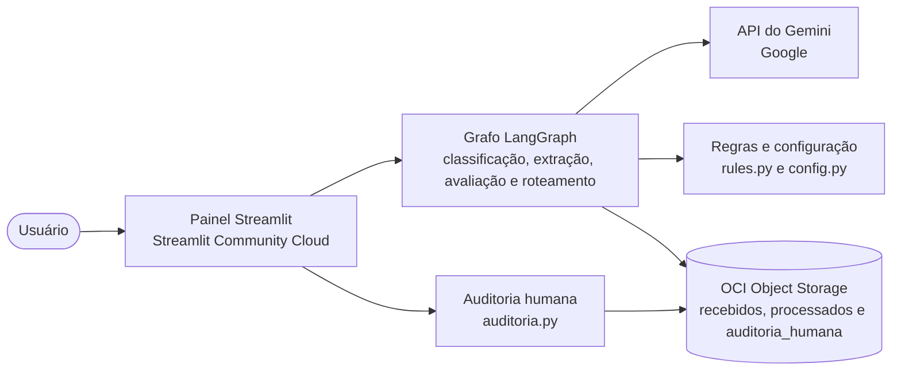
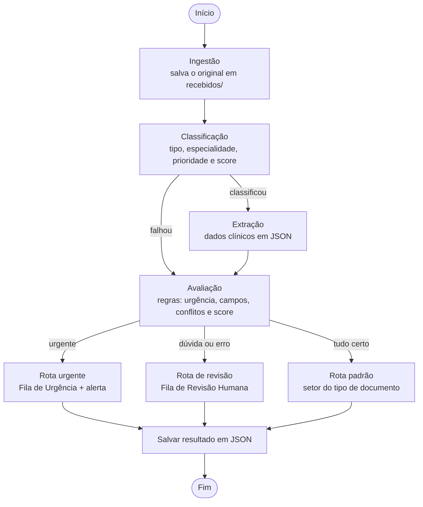

# 🏥 MediFlow

### Agente autônomo para triagem, extração e roteamento de documentos clínicos

Projeto da **Equipe 24** no **Hackathon ONE G10** (Oracle Next Education & Alura), pela plataforma NoCountry.
A descrição original do desafio está em [`MedFlow.pdf`](MedFlow.pdf).

🌐 **Aplicação online:** https://no-country-simulation-g10---brasil---equipo-24-app-inici-eagzc9.streamlit.app/

## Resumo

O MediFlow recebe documentos clínicos e administrativos (laudos, receitas, guias, relatórios de alta e atestados) em **texto, PDF ou imagem**, identifica o tipo, extrai os dados essenciais em JSON validado e decide para onde encaminhar cada um.

Casos urgentes vão direto para a fila de emergência, com alerta. Documentos duvidosos, incompletos ou ilegíveis vão para a **revisão de uma pessoa**. Os casos padrão seguem para o setor correto sem intervenção manual.

## Demonstração

▶️ [Assista à demonstração no YouTube](https://www.youtube.com/watch?v=H7V5tj8-2xs)


## O problema

Hospitais, clínicas, laboratórios e operadoras recebem milhares de documentos por dia, e equipes administrativas os leem manualmente para digitar dados em sistemas legados. Isso é lento, caro e sujeito a erros, e atrasos podem prejudicar pacientes em urgência e gerar glosas em autorizações.

**Público-alvo:** hospitais, clínicas, laboratórios e operadoras de saúde (equipes de auditoria, farmácia, prontuário e plantão médico).

## Arquitetura



- **Painel (`app.py`):** interface em Streamlit, publicada no Streamlit Community Cloud.
- **Grafo (`graph.py`):** liga as etapas em um fluxo com desvios condicionais.
- **IA (`classifier.py` e `extractor.py`):** duas chamadas ao Gemini, uma para classificar e outra para extrair, ambas validadas com Pydantic.
- **Regras (`rules.py` e `config.py`):** decisão final sem IA, previsível e configurável.
- **Armazenamento (`storage.py`):** OCI Object Storage no ambiente publicado, com SeaweedFS (Docker) e pasta local para testes.

## Como funciona

O fluxo é um **grafo de decisão em LangGraph**, com etapas e desvios condicionais:



1. **Ingestão:** guarda o documento original no bucket (`recebidos/`).
2. **Classificação (Gemini):** tipo do documento, especialidade, prioridade (Rotina, Prioritário ou Urgente) e score de confiança.
3. **Extração (Gemini):** paciente, médico e CRM, exame, diagnóstico, CID sugerido e medicamentos (nome, dosagem, posologia e legibilidade), validados com Pydantic.
4. **Avaliação (regras em Python):** urgência, campos faltando, inconsistências e score final.
5. **Roteamento:** urgente, revisão humana ou padrão.
6. **Armazenamento:** grava o resultado em JSON na pasta correspondente.

Se o Gemini falhar, o erro não derruba o sistema: o documento vai para a revisão humana. Os erros técnicos são traduzidos para mensagens claras (`diagnostico.py`), com a indicação do que fazer. O conteúdo dos documentos é tratado como dado, nunca como instrução, para reduzir riscos de manipulação do modelo.

## Regras de decisão

**A IA sugere, a regra confirma.** A decisão final usa regras previsíveis e auditáveis (`rules.py`), e não apenas a opinião do modelo.

- **Urgência:** prioridade "Urgente" sugerida pelo modelo **ou** termos críticos no diagnóstico (ex.: TEP, infarto, AVC, sepse), com tratamento de negações como "sem evidência de…".
- **Revisão humana:** campo obrigatório ausente, medicamento ilegível, inconsistência (ex.: receita sem medicamento), tipo desconhecido, erro de processamento ou score abaixo do limiar.
- **Score final:** parte do score da classificação e desconta cada problema encontrado.

| Situação | Destino |
|---|---|
| Urgente | Fila de Urgência Médica + alerta ao plantão |
| Urgente com dados duvidosos | Mesma fila de urgência, marcada para auditoria humana |
| Dados duvidosos | Fila de Revisão Humana |
| Receituário | Farmácia Hospitalar |
| Guia de procedimento | Auditoria de Autorizações |
| Laudos, relatório de alta e atestado | Prontuário Eletrônico |

O alerta de urgência é uma mensagem gerada na resposta e exibida na tela do painel.

### Regras configuráveis

Os valores abaixo ficam em `config.py` e podem ser alterados **sem mexer no código**, pela aba "Regras de triagem" do painel (salvo em `config_triagem.json`):

| Regra | Valor padrão |
|---|---|
| Limiar de confiança (abaixo dele, vai para revisão) | 0,80 |
| Penalidade por campo obrigatório faltando | 0,20 |
| Penalidade por medicamento ilegível | 0,15 |
| Campos obrigatórios | nome do paciente e CRM do médico |
| Termos de urgência | lista editável (TEP, infarto, AVC, sepse, entre outros) |
| Destino de cada tipo de documento | tabela acima, editável |

## Exemplo de saída

Formato do JSON devolvido pela triagem (valores ilustrativos, com dados fictícios):

```json
{
  "status": "processado",
  "documento_id": "DOC-CLIN-2026-8942",
  "classificacao": {
    "tipo_documento": "Laudo de Exame de Imagem",
    "especialidade": "Radiologia / Pneumologia",
    "nivel_prioridade": "Urgente",
    "score_confianca_classificacao": 0.95
  },
  "dados_extraidos": {
    "paciente": { "nome": "Carlos Eduardo Mendes", "idade": 52 },
    "medico_solicitante": { "nome": "Dra. Renata Silveira", "crm": "145892-SP" },
    "exame_realizado": "Tomografia de Torax com contraste",
    "diagnostico_principal": "Tromboembolismo Pulmonar Agudo (TEP)",
    "cid_sugerido": "I26.9"
  },
  "decisao_roteamento": {
    "destino_principal": "Fila_Emergencia_Medica",
    "requer_auditoria_humana": false,
    "justificativa_roteamento": "Achado critico de alta gravidade detectado.",
    "notificacao_gerada": {
      "canal": "Alerta_Plantao_Medico",
      "mensagem": "ALERTA URGENTE: Laudo critico de TEP para paciente Carlos Eduardo Mendes."
    }
  },
  "armazenamento_oci": {
    "bucket": "mediflow-documentos-clinicos",
    "caminho_objeto": "processados/urgentes/DOC-CLIN-2026-8942.json",
    "status_backup": "sucesso"
  }
}
```

## Tecnologias

| Camada | Tecnologia |
|---|---|
| Linguagem e validação | Python, Pydantic |
| Fluxo do agente | LangGraph |
| IA multimodal | Google Gemini (lê PDF e imagem direto, sem OCR separado) |
| Interface e hospedagem | Streamlit, publicado no Streamlit Community Cloud |
| Armazenamento | OCI Object Storage (Always Free) |
| Teste local do armazenamento | SeaweedFS no Docker (API S3, via `boto3`) |
| Testes | pytest |

## Estrutura do repositório

| Arquivo ou pasta | Função |
|---|---|
| `app.py` | Painel em Streamlit (triagem, auditoria, regras e histórico) |
| `graph.py` | Grafo de decisão em LangGraph que liga todas as etapas |
| `classifier.py` | Classificação do documento com o Gemini |
| `extractor.py` | Extração dos dados com o Gemini e validação do JSON |
| `rules.py` | Avaliação, score e regras de roteamento (sem IA) |
| `config.py` | Regras configuráveis (limiar, termos de urgência, destinos) |
| `schemas.py` | Modelos Pydantic: o "formulário" de cada dado |
| `storage.py` | Armazenamento: OCI, SeaweedFS ou pasta local |
| `auditoria.py` | Fila de revisão humana: listar, corrigir, aprovar ou rejeitar casos e registrar a trilha de auditoria |
| `diagnostico.py` | Traduz erros técnicos (quase sempre do Gemini) para mensagens claras e indica se vale tentar de novo |
| `docker-compose.yml` | Sobe o SeaweedFS para testes locais |
| `documentos_ficticios/` | Documentos de exemplo, todos fictícios |
| `test/` | Testes automatizados (classificador, extrator, regras e schemas), com um Gemini simulado em `fakes.py` |
| `docs/` | Imagens do README |

## Documentos de exemplo

A pasta `documentos_ficticios/` traz arquivos para testar os cenários:

| Cenário | Arquivos |
|---|---|
| Rotina | `01_rotina_receita` (`.pdf`, `.txt` e `.json`) e `02_rotina_receita.txt` |
| Urgência | `02_urgencia_laudo_tep` (`.pdf` e `.txt`) |
| Ambíguo | `03_ambiguo_receita` (`.pdf`, `.txt` e foto `.jpg`) |
| Baixa qualidade | `04_baixa_qualidade_receita_foto.jpg` |

## Como rodar

**Pré-requisitos:** Python 3.10 ou superior, Git e uma chave de API do Gemini (Google AI Studio).

**1. Baixe o projeto**

```bash
git clone https://github.com/No-Country-simulation/G10---BRASIL---EQUIPO-24
cd G10---BRASIL---EQUIPO-24
```

**2. Crie e ative um ambiente virtual**

```bash
python -m venv .venv
# Windows:
.venv\Scripts\activate
# Mac ou Linux:
source .venv/bin/activate
```

**3. Instale as dependências**

```bash
pip install -r requirements.txt
```

**4. Configure o `.env`**

Copie o modelo e preencha a sua chave:

```bash
# Windows:
copy .env.example .env
# Mac ou Linux:
cp .env.example .env
```

O arquivo `.env` guarda segredos e **não vai para o GitHub** (está no `.gitignore`). Nunca publique a sua chave.

**5. Escolha onde guardar os arquivos** (variável `STORAGE_BACKEND` no `.env`)

| Valor | O que faz |
|---|---|
| `local` | Grava em uma pasta do seu computador. Não precisa de Docker nem de nuvem. |
| `seaweedfs` | Usa o SeaweedFS no Docker, que imita um bucket S3 (veja abaixo). |
| `oci` | Usa o OCI Object Storage de verdade (veja abaixo). |

**SeaweedFS (opcional, para simular a nuvem):**

```bash
docker compose up -d
```

No `.env`, use `STORAGE_BACKEND=seaweedfs` e `SEAWEEDFS_ENDPOINT=http://localhost:8333`. O S3 local não tem senha, então use-o apenas na sua máquina.

**OCI (opcional):** configure o arquivo `~/.oci/config` com a sua conta, use apenas recursos Always Free e defina no `.env` `STORAGE_BACKEND=oci` e `OCI_NAMESPACE`. Depois:

```bash
python storage.py --criar-bucket
python storage.py --testar
```

**6. Abra o painel**

```bash
streamlit run app.py
```

O navegador abre em `http://localhost:8501`. Na aba **Nova triagem**, envie um arquivo da pasta `documentos_ficticios/` ou cole um texto.

**7. Rode os testes**

```bash
pytest test
```

Os testes usam um Gemini simulado, então **não precisam de chave de API**.

**Testes pelo terminal, sem o painel** (precisam da chave do Gemini):

```bash
python classifier.py documentos_ficticios/02_urgencia_laudo_tep.pdf
python extractor.py documentos_ficticios/02_urgencia_laudo_tep.pdf
```

## Interface

Painel em **Streamlit** com quatro abas:

- **Nova triagem:** envio de arquivo (PDF, imagem ou texto) ou texto colado, com resultado, justificativa e alerta.
- **Auditoria humana:** lista os casos pendentes, mostra o documento original e os motivos da revisão e permite corrigir os dados (validados pelo mesmo schema da extração), aprovar ou rejeitar. Cada decisão registra quem decidiu, quando e a observação.
- **Regras de triagem:** ajuste de limiar, termos de urgência e destinos, sem mexer no código.
- **Histórico:** objetos gravados no bucket, por pasta.

## Armazenamento

Os arquivos ficam em um bucket (`mediflow-documentos-clinicos`) organizado por status. No ambiente publicado, ele fica no **OCI Object Storage**:

- `recebidos/`: documentos originais
- `processados/`: resultados em JSON, com a subpasta `urgentes/` e uma por destino
- `auditoria_humana/`: casos aguardando revisão (inclui urgências com dados duvidosos)
- `processados/revisados/` e `processados/rejeitados/`: casos já decididos por um auditor, com a trilha de auditoria

Cada registro guarda a resposta da triagem e metadados: data, canal de origem e a avaliação com os motivos.

## Status

- ✅ **Implementado:** classificação, extração, avaliação, roteamento em LangGraph, regras configuráveis, painel com quatro abas, auditoria humana (com correção dos dados e trilha de auditoria), tradução de erros técnicos, armazenamento no **OCI Object Storage** (com SeaweedFS e pasta local para testes), testes automatizados e aplicação publicada no Streamlit Community Cloud.
- 🔭 **Possíveis evoluções:** lista de medicamentos de alto risco, alertas em tempo real (Slack ou e-mail), login no painel, reprocessamento de documentos pelo painel, endpoint REST e deploy no OCI Compute.

## Cuidados e limitações

- Use **apenas documentos fictícios**, sem dados reais de pacientes (LGPD).
- O site publicado **não tem login**: é um protótipo de demonstração. As chaves (Gemini e OCI) ficam fora do repositório.
- O CID-10 é uma **sugestão**, não um diagnóstico.
- A urgência é detectada a partir do diagnóstico extraído. Termos fora de contexto podem gerar alertas desnecessários, o que é preferível a deixar de alertar.
- O alerta de urgência aparece na tela do painel, sem envio por Slack ou e-mail.
- O MediFlow apoia a triagem e **não substitui** profissionais de saúde.

## Equipe

**Equipe 24**

| Integrante | Funções |
|---|---|
| Samuel Piovani | Desenvolvimento, testes e documentação |
| Marcel Fagundes Souza | Desenvolvimento, testes e cloud |
| Leonardo Lacerda | Desenvolvimento |

**Repositório:** https://github.com/No-Country-simulation/G10---BRASIL---EQUIPO-24
